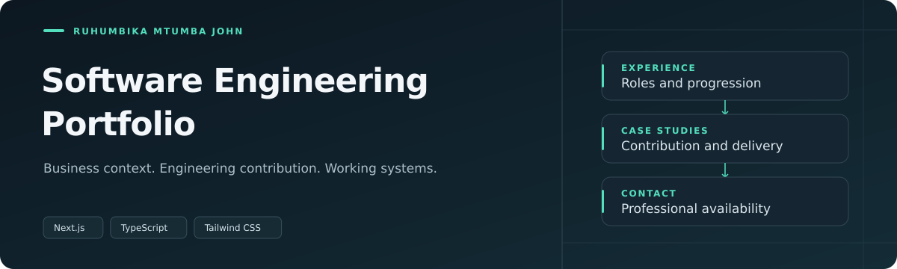

  

[**Visit portfolio**](https://johnportifolio.rjaybarber.shop) · [Experience](https://johnportifolio.rjaybarber.shop/experience) · [Projects](https://johnportifolio.rjaybarber.shop/projects)

My professional portfolio brings together selected projects, experience and public contact information.

### What to explore

| Section | Content |
| :--- | :--- |
| Projects | Selected software projects and my contributions. |
| Experience | Professional roles and career progression. |
| Contact | Public professional contact options. |

---

[Ruhumbika Mtumba John](https://github.com/Ruhumbika) · Software Engineer
